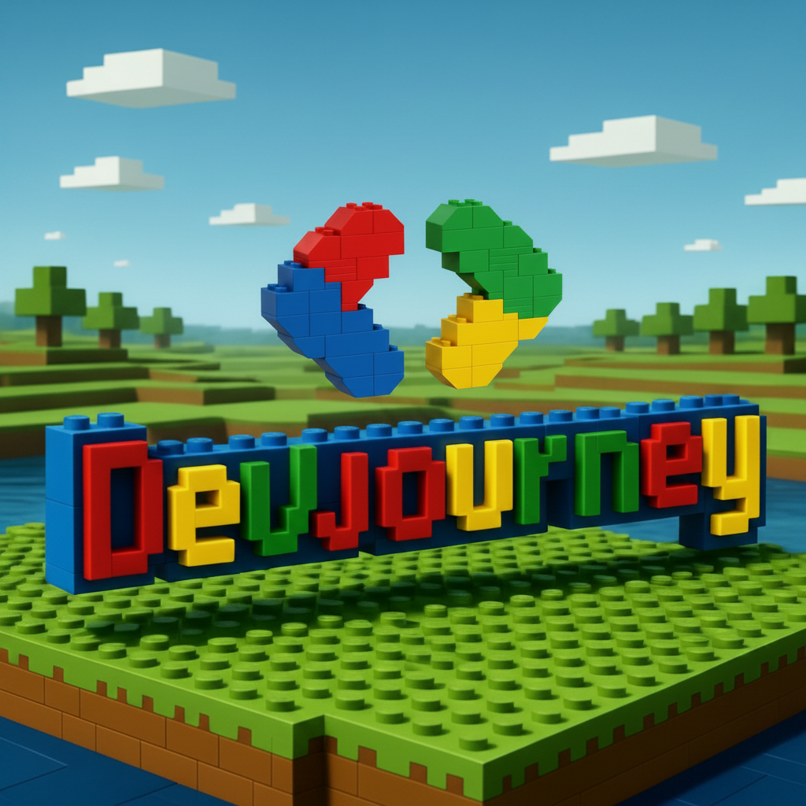

# 🧱 DevJourney - Frontend



DevJourney is an interactive, gamified platform designed for developers to master coding skills, complete real-world missions, and climb the global leaderboard. Modeled with a nostalgic 8-bit, LEGO, and Minecraft-inspired aesthetic, learning to code has never been more fun!

## 🚀 Features

- **Gamified Aesthetics**: A stunning retro UI featuring pixel fonts, vibrant colors, blocky shapes, and satisfying micro-animations.
- **Challenge Dashboard**: An immersive dashboard displaying active challenges depending on your current track (Web, Mobile, Backend, AI).
- **Global Leaderboard**: Compete with other builders. Climb the ranks to earn your golden crown!
- **Mission Submissions**: Submit your GitHub repository links to complete challenges. Admins & Teachers can validate missions and award XP.
- **Persistent Auth**: Secure system with JSON Web Tokens (JWT) handled carefully via Zustand's state management & LocalStorage memory.

## 💻 Tech Stack

- **Framework**: [Next.js 15](https://nextjs.org/) (App Router, Turbopack)
- **Library**: [React 19](https://react.dev/)
- **Styling**: [Tailwind CSS v4](https://tailwindcss.com/)
- **State Management**: [Zustand](https://zustand-demo.pmnd.rs/) with persist middleware
- **Data Fetching**: [Axios](https://axios-http.com/)
- **Form Validation**: [React Hook Form](https://react-hook-form.com/) & [Zod](https://zod.dev/)

## 🏗️ Getting Started

### Prerequisites

Make sure you have Node.js version 18.17+ installed on your system.

### Installation

1. Clone the repository and navigate to the frontend directory:
   ```bash
   cd frontend_devjourney
   ```

2. Install all the dependencies:
   ```bash
   npm install
   ```

3. Configure your environmental variables. Create a `.env.local` file at the root of the frontend folder:
   ```env
   NEXT_PUBLIC_API_URL=http://localhost:5000/api
   ```
   *(Update the URL when running the app in production, e.g., `https://your-backend-url.onrender.com/api`)*

4. Run the development server!
   ```bash
   npm run dev
   ```

5. Open [http://localhost:3000](http://localhost:3000) with your browser to see the result.

## 📂 Project Structure

- `app/` - The Next.js 15 App router structure. Pages (`login`, `register`, `dashboard`, `challenges`, `leaderboard`, etc.).
- `components/ui/` - Highly reusable core UI elements (LegoButton, LegoCard, LegoBadge, LegoInput).
- `components/layout/` - Wrapper components such as the dynamic Navbar.
- `lib/api.ts` - Centralized Axios singleton intercepting requests to inject secure Bearer JWT formats.
- `store/authStore.ts` - Local cache implementation maintaining user session state across refreshes.

## 🚀 Deployment

The smartest way to deploy this Next.js project is on [Vercel](https://vercel.com).
Be sure to declare your environment variable under your Project Settings in Vercel before the build initiates.

```bash
npm run build
```

---
*Built with Bricks & Code.* 🧱
